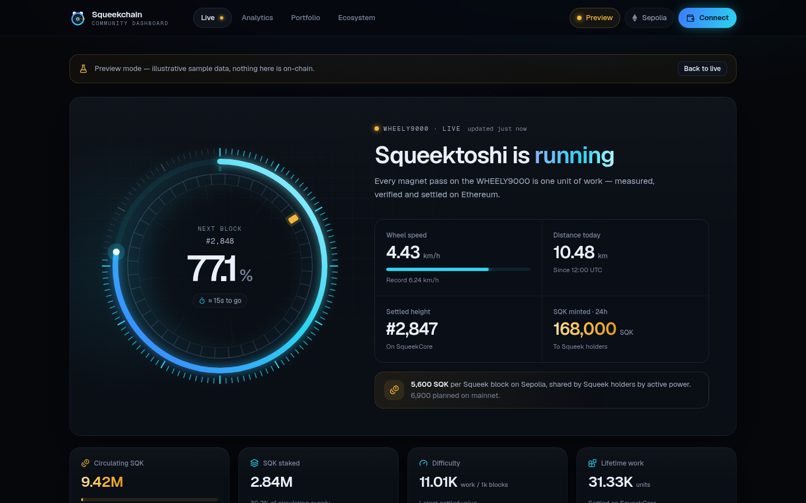
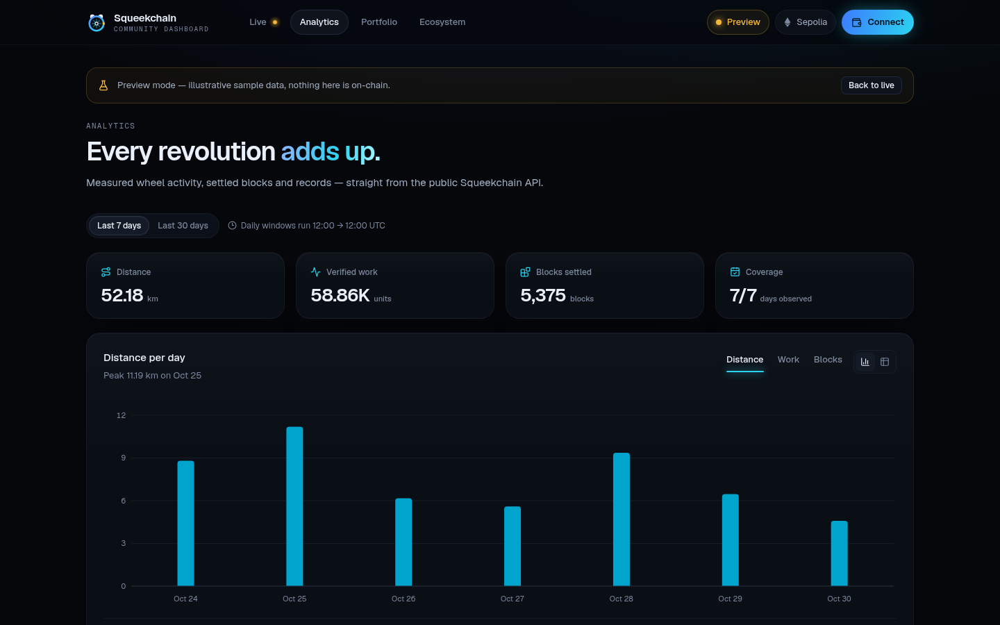
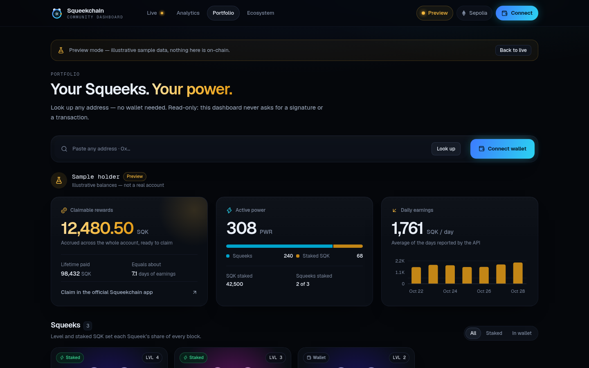
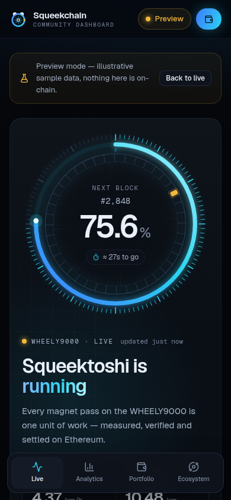

# Squeekchain community dashboard

**Live from the wheel.** A community dashboard for [Squeekchain](https://squeekchain.com) — the proof-of-work toychain on Ethereum powered by Squeektoshi, a real hamster running in the WHEELY9000.

Watch progress toward the next Squeek block in real time, explore the network's history, and look up any Squeek holder — no wallet required.



## What's inside

| View | What it shows |
| --- | --- |
| **Live** | The WHEELY9000 as an instrument: a progress ring to the next Squeek block whose inner wheel turns at the measured wheel speed and lights its sensor on every magnet pass. Wheel status, speed, distance today, settled height, SQK minted in 24 h, network supply and staking, daily activity and a live settlement feed. When a block is found, the ring closes its lap and a gold pulse fires. |
| **Analytics** | One date range for every chart (7 / 30 days, noon-to-noon UTC windows): distance, verified work and settled blocks per day with a chart/table toggle, the typical day on the wheel with the current time slot highlighted, network difficulty and all-time records. |
| **Portfolio** | Paste any address (or connect a wallet, read-only) for claimable SQK, active power split between Squeeks and staked SQK, daily earnings, every Squeek with level, power and custody, and recent activity. Each lookup has a shareable URL: `/portfolio?address=0x…`. |
| **Ecosystem** | The pinned Sepolia contracts with copy and Etherscan links, a live deployment check, the public API in a few lines, the endpoints this dashboard reads, and official resources. |

| Analytics | Portfolio | Mobile |
| --- | --- | --- |
|  |  |  |

## Honest numbers

The dashboard never fills a gap with a guess.

- Unknown, stale or unavailable values render as `—`; days without observations stay blank in every chart.
- **Deployment check.** Contract addresses live in [`lib/contracts.ts`](lib/contracts.ts). If any API response reports a different deployment, every chain-specific value (heights, progress, supply, settlements) is withheld while independent wheel telemetry stays visible. The status pill and banner show which contract differs and what the API reported.
- Wheel telemetry has explicit states — live, idle, stale, counter fault, unavailable — each with its own copy and visual.
- The time-to-next-block estimate appears only after two fresh readings show accepted work; it is labelled as an estimate.
- SQK is shown on a settlement only when its issuance is confirmed on-chain; nothing multiplies blocks by a fixed reward.
- **Preview mode** (status pill → Preview, or `?preview=1`) runs on clearly labelled sample data that moves on its own, so every state — including a found block — can be explored when the API is quiet. It is never used as a fallback for live data.

> Contract addresses follow what the public API currently serves (SqueekCore `0x980b…3d44`, a newer Sepolia deployment). They may differ from docs.squeekchain.com until the documentation is updated. SqueekCore is the anchor: if the API ever reports another core, chain data is withheld.

## Design system

- **Surfaces:** near-black page (`#05070b`) with three raised steps and hairline borders; cards carry a pointer-following spotlight.
- **Accents:** electric cyan for work and live state, gold for SQK and rewards. Chart marks use deeper steps (`#00a4cc`, `#c38616`) validated as a pair on the card surface (OKLCH lightness band, CVD ΔE 21.6, normal-vision ΔE 24.9, ≥ 3:1 contrast); hover lifts a mark to the bright brand step.
- **Type:** Geist Sans with proportional figures for headline numbers, tabular figures for tables and axes; Geist Mono for addresses and labels.
- **Motion:** springs for progress and numbers, a shared sliding pill for navigation and tabs, staggered entries for new settlements. Everything respects `prefers-reduced-motion`.

## Stack

Next.js 16 (App Router) · React 19 · TypeScript · Tailwind CSS 4 · Motion · Recharts · Lucide. No backend, no API key: the browser reads the public API at `https://api.squeekchain.com/v1` and an injected EIP-1193 wallet when one is connected.

```
app/                 routes (Live, Analytics, Portfolio, Ecosystem) and the Open Graph image
components/live/     hero, wheel ring, network stats, activity, settlement feed
components/…         analytics, portfolio, ecosystem, shell (header, status, banner) and UI primitives
lib/squeek-api.ts    network adapter: schema checks, units, caching, back-off, deployment isolation
lib/account-api.ts   account adapter for portfolios
lib/contracts.ts     pinned deployment, protocol constants and links
scripts/verify-squeek-api.mjs   network-free adapter tests
```

## Run it

Requires Node.js 22.13 or newer.

```sh
npm ci
npm run dev        # http://localhost:3000
npm run test:api   # adapter tests: unavailable/stale states, back-off, schema and deployment isolation
npm run typecheck
npm run lint
npm run build
```

Deploys to Vercel with zero configuration.

## Polling and failure handling

The visible tab polls every 15 seconds and pauses when hidden. Each endpoint has its own cache TTL; failures back off (30 s for telemetry, 60 s otherwise) and honour `Retry-After`. Requests time out after 8 seconds. Refetches keep the previous render on screen — no skeleton flash, no layout jump.

## History

The first, Codex-generated version of this dashboard is preserved at the [`v0-codex`](https://github.com/h0xva/squeekchain-dashboard/tree/v0-codex) tag.

---

An independent community project, not affiliated with Squeekchain. Sepolia testnet — SQK has no monetary value.
